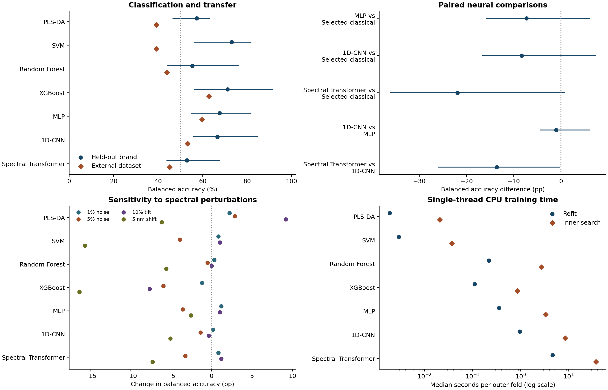

# Honey adulteration detection from near-infrared spectra

This study compares PLS-DA, SVM, Random Forest, XGBoost, MLP, 1D-CNN and a Spectral Transformer on the binary task of distinguishing pure honey from laboratory-adulterated honey. It evaluates held-out brands, sensitivity to spectral perturbations, transfer to a second public dataset and single-thread CPU cost. Balanced accuracy, the mean of sensitivity and specificity, is the primary metric.

Open the [executed Jupyter notebook](notebooks/honey_adulteration_analysis.ipynb) for the results, figures, and links to every analysis record. To rerun the notebook locally using the archived outputs, install `requirements.txt` and `jupyterlab`, then open the notebook from the repository in JupyterLab. Raw spectra are retrieved from the cited releases by the reproduction commands.

The [24-lot feasibility pilot](PILOT.md) provides the instrument check, randomized scan schedule and pilot analysis. The [follow-up validation protocol](FOLLOWUP.md) provides the sample-size planner and blinded lot-level evaluation workflow for SVM, XGBoost and MLP.

The [research manuscript](paper/honey_adulteration_manuscript.pdf) incorporates the seven-model study and the 850–1000 nm Auckland-to-Padua transfer experiment. The [reproduction guide](paper/REPRODUCE.md) links the original sources and explains how to verify the reported results from observation-level predictions.

## Findings

**Increasing neural complexity did not improve detection in this benchmark.** SVM achieved the highest held-out-brand balanced accuracy among individual models (73.1%). The training-selected classical procedure reached 74.9%, ahead of the MLP (67.6%), 1D-CNN (66.6%) and Spectral Transformer (53.0%). None of the five directional neural superiority tests passed Holm correction. XGBoost led external balanced accuracy at 62.9%, detecting 8 of 31 adulterated preparations. That low sensitivity limits use as a screening test under this transfer setting.



### Classification and generalization

| Model | Held-out brand BA (95% interval) | Accuracy | Macro-F1 | ROC AUC | External BA | External sensitivity / specificity |
| --- | ---: | ---: | ---: | ---: | ---: | ---: |
| PLS-DA | 57.3% (46.4–63.2) | 86.0% | 0.588 | 0.668 | 39.2% | 45.2% / 33.3% |
| SVM | **73.1%** (56.0–82.0) | 67.2% | 0.579 | 0.692 | 39.2% | 45.2% / 33.3% |
| Random Forest | 55.4% (43.9–76.3) | 79.1% | 0.551 | 0.745 | 43.8% | 71.0% / 16.7% |
| XGBoost | 71.2% (56.1–91.8) | 83.6% | **0.679** | **0.867** | **62.9%** | 25.8% / 100.0% |
| MLP | 67.6% (54.8–82.0) | 66.6% | 0.559 | 0.662 | 59.7% | 19.4% / 100.0% |
| 1D-CNN | 66.6% (55.8–85.1) | 66.6% | 0.555 | 0.537 | 53.2% | 6.5% / 100.0% |
| Spectral Transformer | 53.0% (43.8–68.0) | 73.1% | 0.518 | 0.651 | 45.2% | 90.3% / 0.0% |
| Selected classical | 74.9% (57.3–85.6) | 70.4% | 0.605 | 0.702 | 62.9% | 25.8% / 100.0% |

BA denotes balanced accuracy. Accuracy, macro-F1 and ROC AUC in the middle columns refer to the Auckland folds. The 95% intervals resample brands and condition on their fitted predictions. The classical selection rule picked SVM in four outer folds and XGBoost in three, then selected XGBoost for the full-source transfer fit. An always-adulterated rule would score 87.5% accuracy and 50.0% balanced accuracy in Auckland. PLS-DA’s high accuracy likewise coincided with 19.0% specificity.

Every model’s balanced accuracy declined in the one-way transfer from Auckland to Argentina. The external MLP scored the highest ROC AUC (0.731) but detected only 6 of 31 adulterated preparations at its source-trained threshold. The Transformer called all six pure preparations adulterated. Instrument, sample preparation, adulterant composition and concentration changed together between releases, so the transfer results reflect their combined shift. Six pure preparation labels provide a coarse estimate of specificity.

### Statistical comparison of model complexity

| Direction tested | BA difference (percentage points) | Paired 95% interval | One-sided p | Holm p |
| --- | ---: | ---: | ---: | ---: |
| MLP over selected classical | −7.32 | −15.89 to +6.17 | 0.844 | 1.000 |
| 1D-CNN over selected classical | −8.34 | −16.67 to +7.40 | 0.813 | 1.000 |
| Spectral Transformer over selected classical | −21.92 | −36.25 to +0.89 | 0.875 | 1.000 |
| 1D-CNN over MLP | −1.02 | −4.48 to +6.19 | 0.625 | 1.000 |
| Spectral Transformer over 1D-CNN | −13.58 | −26.11 to −0.14 | 0.906 | 1.000 |

All five point estimates favored the simpler or classical comparator. The MLP-to-CNN interval spans performance differences in both directions, and the inferential unit is the brand, with seven available. The comparison addresses these architectures, search grids and data. Excluding the six merged Manuka keys from scoring preserved the ordering of all seven models.

### Robustness

| Model | 1% noise Δ BA | 5% noise Δ BA | 10% tilt Δ BA | 5 nm shift Δ BA | Sensitivity at 5% dose | Sensitivity at 10% dose |
| --- | ---: | ---: | ---: | ---: | ---: | ---: |
| PLS-DA | +2.2 | +2.9 | +9.2 | −6.2 | 96.2% | 93.9% |
| SVM | +0.9 | −3.9 | +1.0 | −15.7 | 48.7% | 50.0% |
| Random Forest | +0.3 | −0.5 | 0.0 | −5.6 | 88.5% | 80.3% |
| XGBoost | −1.2 | −6.0 | −7.7 | −16.3 | 84.6% | 86.4% |
| MLP | +1.2 | −3.6 | +1.0 | −2.5 | 56.4% | 63.6% |
| 1D-CNN | +0.2 | −1.4 | −0.3 | −5.1 | 56.4% | 63.6% |
| Spectral Transformer | +0.9 | −3.2 | +1.2 | −7.3 | 79.5% | 74.2% |

Changes in balanced accuracy are in percentage points. A 5 nm shift reduced balanced accuracy for all seven models. MLP was the least sensitive to this shift, retaining 65.1% balanced accuracy, while SVM fell to 57.4%. At the nominal 5% dose, SVM detected 38 of 78 cases and XGBoost detected 66. PLS-DA’s high positive detection at that dose accompanied its low clean-data specificity of 19.0%. These stress tests describe fixed perturbations of the released spectra.

### Computational efficiency

| Model | Median refit (s) | Median search (s) | Single spectrum (µs) | Batch of 128 (µs/spectrum) | Model (KiB) | Neural parameters |
| --- | ---: | ---: | ---: | ---: | ---: | ---: |
| PLS-DA | 0.0019 | 0.021 | 211 | 2.1 | 50.9 | — |
| SVM | 0.0029 | 0.037 | 273 | 5.2 | 47.3 | — |
| Random Forest | 0.2173 | 2.724 | 10,953 | 92.0 | 291.4 | — |
| XGBoost | 0.1108 | 0.867 | 819 | 9.0 | 133.4 | — |
| MLP | 0.3561 | 3.319 | 325 | 3.9 | 8.6 | 2,113 |
| 1D-CNN | 0.9548 | 8.550 | 721 | 19.6 | 11.7 | 2,913 |
| Spectral Transformer | 4.6082 | 36.885 | 1,210 | 61.9 | 153.7 | 38,881 |

The Transformer took about 13 times as long as the MLP to refit and 16 times as long per spectrum in batches of 128. The MLP was smaller on disk and faster than SVM in that batch setting. SVM combined the highest individual held-out-brand balanced accuracy with a 2.9 ms median refit. XGBoost offered the strongest within-brand ranking by ROC AUC and the highest external balanced accuracy, with low external sensitivity at the fixed threshold.

## Data and observation units

| Public dataset | Role | Input data | Observations analyzed |
| --- | --- | --- | ---: |
| University of Auckland, New Zealand | Model selection and leave-one-brand-out evaluation | Published wavelength columns from SOC-710 hyperspectral imagery, sugar-syrup additions at nominal 5%, 10%, 25% and 50% | 335, including 42 pure and 293 adulterated |
| NIRPY Research / Mercedes Bertotto, Argentina | External evaluation of models trained on all Auckland brands | Published spectra with identifiers for pure honey and honey mixtures containing `GLU`, `RS` or `JMAF` syrup | 37, including 6 pure and 31 adulterated |

- **Auckland.** Excluded 150 pure-sugar segments. Averaged the remaining 8,525 segments by brand, product, acquisition, nominal concentration and exact concentration. Each key held 25 segments except for six C9 Manuka 10% keys with 50 segments each. The release could not distinguish the two images within these keys, so each was represented by a single joint mean. The retained observations cover 12 brand–product combinations and seven brands. Brands C4 and C5 have no pure observations in the CSV. The paper also documents that its pure examples originated from an earlier botanical-origin dataset, leaving a possible association between class and acquisition campaign. The CSV names wavelength columns through 1063.79 nm, while the paper and dictionary describe acquisition through 1000 nm. The benchmark stops at 1000 nm. [Versioned dataset and data dictionary (CC BY 4.0)](https://doi.org/10.17608/k6.auckland.16441686.v1) · [Phillips and Abdulla, 2023](https://doi.org/10.1007/s00217-022-04113-9)
- **Argentina.** The 165 spectra follow a separate wavelength metadata row. The header values convert from reciprocal centimeters to nanometers and match the rounded second axis. Excluded five scans of pure adulterant and six scans with an ambiguous preparation label and no explicit spike percentage. Averaged 154 remaining scans by normalized preparation label after removing terminal scan letters. Preserved the `>10%` qualifier. The six pure preparation labels may share parent honey, and the file has no verified parent-lot identifiers. External metrics are descriptive and have no inferential intervals or p-values. [Data release and attribution](https://nirpyresearch.com/aquagrams-python-matplotlib/) · [Pinned source CSV](https://github.com/nevernervous78/nirpyresearch/blob/0efbcf0fcd97580dbffd79e857d70d8f001cf5ff/data/Honey2021.csv)

## Benchmark protocol

**Preprocessing.** Every model uses the same 48-point, evenly spaced 780–1000 nm grid. Linear interpolation uses 41 native in-range channels in Auckland and 14 in Argentina plus adjacent boundary bands where needed. The 48 grid positions represent interpolated inputs. Standard normal variate (SNV) is applied independently to each resampled observation. Channel-wise centering and scaling are fitted using the training partition of each inner and outer fit. Models receive wavelength intensities only. Metadata determine targets, grouping and subgroup metrics.

**Validation.** The seven Auckland outer folds hold out an entire brand, including all its products, acquisitions and doses. Each outer training set uses three `GroupKFold` folds by brand for hyperparameter selection. Each of the seven models gets four prespecified candidates ranked by balanced accuracy on pooled inner validation predictions. Pooling retains single-class folds in the analysis. Exact ties use the first candidate listed in [models.py](models.py). The classical selection procedure selects among the four classical models on these same training-only inner results and inherits its selected model’s outer predictions. The final external fit repeats the same grouped tuning on all Auckland brands, then fits on all Auckland observations and scores the Argentine data without target calibration or threshold fitting. [Varma and Simon, 2006](https://doi.org/10.1186/1471-2105-7-91)

**Models.** PLS-DA regresses binary labels and applies a 0.5 threshold. SVM uses linear or RBF kernels and a zero margin. Random Forest and XGBoost use 150 trees and a 0.5 probability threshold. Class balancing uses inverse-frequency weighting in SVM and Random Forest, and the ratio of negative to positive training cases for XGBoost and the neural loss. The MLP uses two dense hidden layers. The CNN uses two spectral convolutions and pooling. The Transformer uses nonoverlapping four-channel patches, learned positional embeddings, two four-head encoder layers and mean pooling. All neural fits use weighted binary cross-entropy, AdamW, 45 epochs, batches of up to 64, and a zero logit threshold. Initialization and minibatch shuffling are seeded. Architecture, preprocessing and search grids are fixed for this benchmark.

**Classification.** Report pooled balanced accuracy, accuracy, macro-F1, sensitivity and specificity across held-out observations. The Auckland ROC AUC is the unweighted average of the five test brands containing both classes, avoiding pooling of decision scores from different fitted models. The external ROC AUC is calculated over all 37 preparations from the single final fit per model. Raw confusion counts and dose-specific sensitivities are retained.

**Statistical comparison.** Five one-sided contrasts ask if each neural architecture improves over the training-selected classical procedure, if the 1D-CNN improves over the MLP, and if the Transformer improves over the 1D-CNN. Exact enumeration swaps paired predictions within each of the seven held-out brands as a whole, yielding 128 sign patterns for the observed brand contributions to pooled balanced accuracy. Holm adjustment controls the five-comparison family at 0.05 under the test’s exchangeability assumption. Paired percentile intervals use 20,000 bootstrap draws of whole brands, retaining draws with both classes and recomputing pooled balanced accuracy. The intervals are marginal and condition on the fitted out-of-fold predictions. With seven brands and overlapping training sets, the tests and intervals quantify evidence within this benchmark under those assumptions. They offer limited precision for population-wide differences or equivalence. [Bates, Hastie and Tibshirani, 2024](https://doi.org/10.1080/01621459.2023.2197686)

**Robustness.** Apply perturbations only to the untouched Auckland test observations on the common grid before SNV. Gaussian noise uses 1% and 5% of the observation’s spectral standard deviation, with the same noise draw rescaled at both levels. A linear tilt has a peak-to-peak amplitude of 10% of the observation’s spectral range. A randomly signed 5 nm wavelength shift uses interpolation with edge values held constant. Perturbations are shared across models. Nominal dose sensitivity is measured on the clean held-out data. These stress amplitudes are synthetic and were chosen to compare the fitted models on common disturbances.

**Efficiency.** Record final model fit time, inner search time across the 12 candidate–fold fits, model-only serialized size and median prediction time from already resampled inputs. The run used one CPU thread on an AMD Ryzen 5 4600H. Prediction timings include SNV and channel scaling, with three warmups per batch size. Report medians across the seven outer fits for single inputs and batches of 128, cycling through test spectra to fill a batch. The CSV retains preprocessing time, training size and fold-level values. Classical estimators are pickled as objects, and neural sizes use a pickled NumPy state dictionary. Timings and serialized sizes are implementation- and host-dependent. Acquisition, image averaging, resampling and disk I/O are outside these timings.

## Reproduce the study

Run from this directory with Python 3.13 and a CPU-capable PyTorch build. A rerun with a different output path preserves the supplied results.

```powershell
python -m pip install -r requirements.txt
python benchmark.py --download --out reproduced
python summarize.py --out reproduced
```

`--download` retrieves missing source CSVs and checks their SHA-256 hashes. With existing files in `data/`, the benchmark runs offline and verifies the same hashes. The source links and pinned digests are in [datasets.py](datasets.py). [Run metadata](results/run.json) records the package builds, operating system, CPU setting, seed, sample counts and wavelength grid. The measured search and refit time totaled about eight minutes. Timing values will vary.

Verification independently recomputed the balanced accuracies and all five exact permutation p-values from the saved predictions, checked the split and tuning manifests, and reproduced the seven models’ decision scores on held-out brand C1 and the external dataset by refitting the selected configurations.

| Result | Contents |
| --- | --- |
| [Prediction records](results/predictions.csv) | Observation IDs, held-out folds, labels, model scores and decisions |
| [Split manifest](results/splits.json) and [tuning records](results/tuning.csv) | Outer and inner brand assignments, all candidate scores and selections |
| [Classification metrics](results/metrics.csv) and [per-brand results](results/by_brand.csv) | Classification scores and confusion counts |
| [Model comparisons](results/comparisons.csv) and [brand uncertainty](results/brand_uncertainty.csv) | Paired differences, intervals and p-values |
| [Perturbations](results/robustness.csv), [dose sensitivity](results/by_dose.csv) and [external syrup strata](results/external_by_adulterant.csv) | Robustness and subgroup results |
| [Efficiency summary](results/efficiency.csv) and [fold timings](results/timings.csv) | Fit and search time, latency, model size and neural parameter counts |
| [Auckland observation manifest](results/auckland_observations.csv) and [Argentina observation manifest](results/nirpy_observations.csv) | Evaluation units, labels and counts of source rows averaged |
