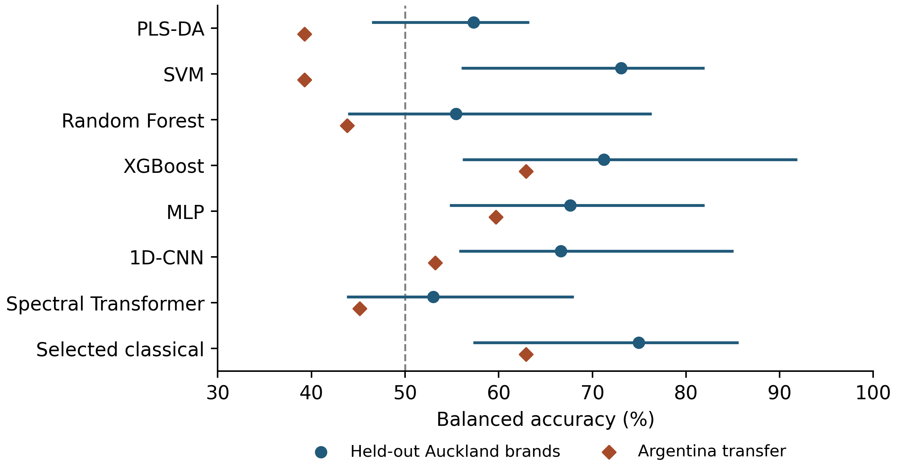
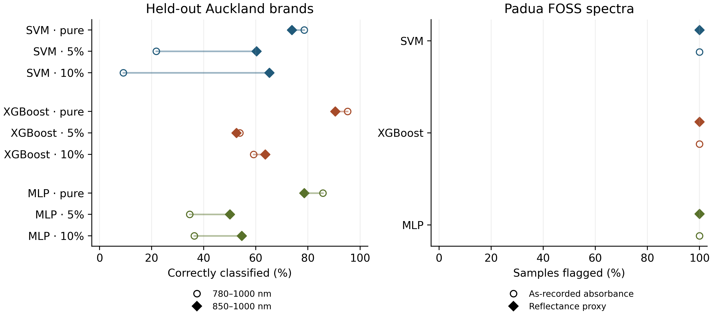

# Comparative evaluation of near infrared models for honey adulteration detection

## Abstract

Near-infrared spectroscopy can screen honey for adulteration, but performance estimates depend on how related spectra are split and whether the measurement setting changes. We compared seven classifiers on 335 image-key observations from seven Auckland brands using nested brand-held-out validation. We tested spectral perturbations, recorded CPU cost, and evaluated transfer to 37 labeled Argentine preparations. The training-selected classical procedure achieved 74.9% Auckland balanced accuracy. The strongest neural classifier, the multilayer perceptron, was 7.3 percentage points lower, with a conditional 95% paired interval of −15.9 to +6.2 points. XGBoost led Argentine balanced accuracy at 62.9% and detected 8 of 31 adulterated preparations. After restricting the window to 850–1000 nm and calibrating on separate Auckland brands, XGBoost achieved 90.5% held-out specificity and 52.6% and 63.6% sensitivity at nominal 5% and 10% adulteration. Transferred to Padua, all three frozen models flagged all 80 samples under both signal representations. Padua lacks adjudicated adulteration labels, so this measures flagging frequency. Additional neural complexity increased computational cost. The paired estimates favor simpler models in this benchmark, with substantial uncertainty about the size of the difference. The transfer results support instrument-specific validation before screening use.

**Keywords** Honey authentication, near-infrared spectroscopy, grouped cross-validation, spectral classification, instrument transfer

## 1 Introduction

Near-infrared (NIR) spectroscopy provides a rapid measurement of honey composition, but spectral differences associated with dilution and added sugars can overlap natural variation in moisture, botanical origin, and sugar composition. Published honey studies report promising discrimination using portable or benchtop NIR and hyperspectral systems. Performance varies with the instrument, sampling design, and concentration of the adulterant [1,2]. An analytical screening model therefore needs evidence about missing low-dose adulteration and flagging ordinary honey under the intended measurement conditions [3].

Public spectral releases make a head-to-head comparison possible, but their observation counts can overstate the number of independent honey sources. In the Auckland release, 25 segments may originate from a single captured image, and multiple preparations and images may belong to one product or brand [1,4]. A model assessed on random segments may benefit from near-neighbor spectra from the same source. We evaluated seven classifiers with whole brands held out for testing. We asked whether neural complexity improves balanced accuracy, how model rankings change under fixed spectral perturbations, and how much performance survives transfer to independent releases.

We also examined the effect of restricting the wavelength grid from 780–1000 nm to 850–1000 nm. That reduced window overlaps the Auckland imagery and the University of Padua FOSS benchtop measurements [4,6,7]. This extension addressed low-dose detection after source-only threshold calibration and measured how often the frozen models flagged honey in the independent, unspiked research cohort. The original benchmark and the window comparison use different threshold protocols and answer different questions.

## 2 Materials and methods

### 2.1 Datasets and analysis units

Table 1. Public datasets and analysis units.

| Release | Analysis unit | Counts used | Role |
| --- | --- | --- | --- |
| Auckland [1,4] | Mean spectrum per image key, grouped by brand | 335 (42 pure, 293 adulterated), seven brands | Model development, held-out evaluation and cutoff calibration |
| Argentina [5] | Mean spectrum per normalized preparation label | 37 (6 pure, 31 adulterated) | Labeled transfer at 780–1000 nm |
| Padua [6,7] | FOSS DS-2500 spectrum per released sample ID | 80 samples, no controlled spike labels | Transfer flag rate at 850–1000 nm |

For Auckland, we removed 150 pure-sugar segments and averaged the remaining 8,525 rows by brand, botanical product label, acquisition, and nominal and exact concentration. The resulting 335 observations included 42 pure controls and 293 adulterated observations. Six Manuka 10% keys each contained 50 segments from two images with indistinguishable released identifiers and were represented by joint means. The 5%, 10%, 25%, and 50% groups contained 78, 66, 72, and 77 observations respectively. The two brands C4 and C5 contributed only adulterated observations. The release also draws pure imagery from earlier work [1], so acquisition campaign may be associated with class. The seven released brand codes defined the grouping unit used for model assessment and uncertainty.

The Argentine file includes a separate wavelength reference row below its wavenumber header. We converted the header from reciprocal centimeters to nanometers, checked agreement with the rounded reference axis, removed five pure-adulterant scans and six scans with ambiguous labels, and averaged the remaining 154 scans within normalized preparation identifiers. This yielded 37 preparation labels with 6 pure and 31 adulterated. The source uses the codes GLU, RS, and JMAF and includes different nominal spike concentrations [5]. Parent-batch identifiers are unavailable. Argentine metrics describe this release at the preparation-label level.

The Padua workbook provides matched sample IDs and chemistry and botanical metadata for 80 Italian honey samples [6,7]. All 80 had a FOSS DS-2500 spectrum, recorded as absorbance in transflectance geometry in the source study [7]. The FOSS wavelength headers run from 850 to 2499.5 nm. The other two instruments start above 1000 nm and did not enter the Auckland-to-Padua extension. The Padua experiment concerns flagging frequency. The data release provides composition and provenance labels without a controlled adulteration panel or individual independent adulteration adjudication.

### 2.2 Seven model benchmark and preprocessing

We compared partial least squares discriminant analysis (PLS-DA), support vector machines (SVM), random forest, XGBoost, a multilayer perceptron (MLP), a one-dimensional convolutional neural network (1D-CNN), and a compact Spectral Transformer. We interpolated all published spectra to 48 equally spaced points between 780 and 1000 nm, applied standard normal variate (SNV) within each observation, and fitted column means and scales on training data in each split. All models received the same 48 intensity features. We set the upper limit at 1000 nm, consistent with Auckland’s stated acquisition range despite CSV columns beyond that limit [1,4]. Native densities differed between datasets, with 41 and 14 in-range channels for Auckland and Argentina respectively.

The seven outer Auckland folds each held out a whole brand. Three grouped inner folds selected one of four candidates per model by pooled balanced accuracy. The selected classical procedure used the same inner predictions to select among PLS-DA, SVM, random forest, and XGBoost. Grouping kept all acquisitions, products, and concentrations from the same brand together. Preprocessing and tuning occurred inside training partitions, following the separation between model selection and performance estimation in nested validation [8]. The Argentina experiment repeated grouped tuning on all Auckland brands, refitted on the full Auckland data, and applied the resulting Auckland fits to Argentina without target adaptation.

PLS-DA fitted a 0/1 regression with a 0.5 decision cutoff. Candidate component counts were 2, 4, 8, and 12. SVM used linear or radial basis kernels with inverse-frequency class weights. Random forest and XGBoost used 150 trees and a 0.5 cutoff. The three neural classifiers used a zero-logit cutoff, class-weighted binary cross-entropy, AdamW, 45 epochs, and batches of at most 64. The MLP had two dense hidden layers. The CNN used two spectral convolutions and pooling. The Transformer embedded four-channel patches and used two four-head self-attention encoder layers with learned position embeddings and mean pooling. All seeds and search candidates are available with the code.

### 2.3 Endpoints and statistical analysis

The primary benchmark endpoint was pooled balanced accuracy, the arithmetic mean of sensitivity and specificity. We also report pooled accuracy and macro-F1, and average ROC AUC across Auckland test brands containing both classes. Argentine ROC AUC was computed for the external preparation labels under each single frozen classifier. Dose-specific sensitivity was computed from the clean held-out source predictions.

Five exploratory directional contrasts compared each neural classifier with the training-selected classical procedure, the 1D-CNN with the MLP, and the Transformer with the 1D-CNN. We enumerated 128 sign patterns for the seven paired brand contributions to balanced accuracy and applied Holm correction [9]. We also recorded each contrast’s number of nonzero brand contributions and minimum attainable one-sided p-value for the observed contribution magnitudes. Conditional 95% intervals used 20,000 brand bootstrap draws from fixed held-out predictions and retained draws containing both classes. Overlapping training sets and seven brand groups limit inferential precision and the exchangeability of cross-validated differences [10].

### 2.4 Perturbations and computational cost

We tested four perturbations of the clean test spectra before SNV. These were shared Gaussian noise at 1% and 5% of each spectrum’s standard deviation, a linear tilt with amplitude equal to 10% of its spectral range, and a randomly signed 5 nm shift with boundary values held constant. The perturbations were applied only at prediction time. CPU timings used one thread and a fixed warmup for each model and batch size. We measured refit and hyperparameter-search time separately and recorded prediction latency from resampled spectra, including SNV and channel scaling. Acquisition, resampling, and disk input/output were outside these timings.

### 2.5 Wavelength restriction and Padua transfer

We fit SVM, XGBoost, and MLP on the 780–1000 nm reference window and the 850–1000 nm matched window, each with 48 interpolated inputs and the same preprocessing and candidate grids. Each Auckland test brand was excluded from both model development and threshold calibration. A deterministic seeded rule selected two of the remaining pure-containing brands for calibration, and the four other brands were used for development. Inner leave-one-development-brand-out validation selected the model configuration. At the final fitted score scale, the decision threshold was the lowest observed pure-control score that reached 90% empirical specificity in the calibration brands. Positive predictions required a score strictly above this threshold. Both windows used the same development, calibration, and test assignments. We report observed held-out specificity and sensitivity at 5% and 10%. Paired uncertainty for the narrower-minus-reference difference resampled whole brands and is descriptive.

For Padua transfer, a separate fit used five Auckland development brands and two for calibration. The preprocessing and thresholds were frozen before reading the Padua workbook. Interpolated absorbance A was converted to the reflectance proxy 10 to the power −A, following the orientation of the reported log(1/R) transform [7]. We also scored the as-recorded absorbance with the same models. To describe spectral shift, we counted how many of each observation’s 48 features after SNV fell outside the corresponding minimum and maximum in the Auckland development partition. Padua outcomes are flag counts at the frozen thresholds.

## 3 Results

### 3.1 Accuracy and neural complexity

SVM achieved the highest balanced accuracy among individual classifiers (73.1%), while the training-selected classical procedure, which selected SVM in four outer folds and XGBoost in three, reached 74.9%. XGBoost achieved the highest mean within-brand ROC AUC (0.867) and macro-F1 (0.679). PLS-DA achieved 86.0% accuracy with 19.0% specificity. An always-adulterated rule would have achieved 87.5% accuracy and 50.0% balanced accuracy. Table 2 and Figure 1 show the class-balanced performance in both cohorts.

Table 2. Clean-data results from the seven-model benchmark.

| Model | Auckland BA % (95% interval) | Auckland specificity % | Auckland sensitivity % | Auckland AUC | Argentina BA % |
| --- | ---: | ---: | ---: | ---: | ---: |
| PLS-DA | 57.3 (46.4–63.2) | 19.0 | 95.6 | 0.668 | 39.2 |
| SVM | 73.1 (56.0–82.0) | 81.0 | 65.2 | 0.692 | 39.2 |
| Random forest | 55.4 (43.9–76.3) | 23.8 | 87.0 | 0.745 | 43.8 |
| XGBoost | 71.2 (56.1–91.8) | 54.8 | 87.7 | 0.867 | 62.9 |
| MLP | 67.6 (54.8–82.0) | 69.0 | 66.2 | 0.662 | 59.7 |
| 1D-CNN | 66.6 (55.8–85.1) | 66.7 | 66.6 | 0.537 | 53.2 |
| Spectral Transformer | 53.0 (43.8–68.0) | 26.2 | 79.9 | 0.651 | 45.2 |
| Selected classical | 74.9 (57.3–85.6) | 81.0 | 68.9 | 0.702 | 62.9 |

BA, balanced accuracy. Auckland intervals are conditional percentile intervals from brand resampling. Auckland AUC averages the five held-out brands containing both classes. The selected classical rule chose XGBoost for the full-source Argentine transfer fit.

Figure 1. Balanced accuracy by model and cohort in the seven-model benchmark. Auckland error bars denote conditional 95% brand bootstrap intervals. Argentine point estimates describe the 37 preparation labels. The dashed line marks the always-positive or always-negative balanced accuracy of 50%.

All directional point estimates favored the simpler or classical comparator. The MLP was 7.32 percentage points below the selected classical procedure, with a paired interval of −15.89 to +6.17. The Transformer was 13.58 points below the 1D-CNN. Under the observed contribution magnitudes, each contrast had at most six nonzero brand contributions. Its minimum attainable one-sided p-value was at least 1/64 (0.015625), above the first Holm cutoff of 0.01 (Table 3). The effect estimates and intervals therefore carry the interpretation. Excluding six merged 10% image keys at scoring preserved the model ordering.

Table 3. Paired directional neural comparisons on the Auckland holdouts.

| Model and comparator | BA difference, points | 95% paired interval | Nonzero brands | One-sided p | Holm p |
| --- | ---: | ---: | ---: | ---: | ---: |
| MLP vs selected classical | −7.32 | −15.89 to +6.17 | 6 | 0.844 | 1.000 |
| 1D-CNN vs selected classical | −8.34 | −16.67 to +7.40 | 6 | 0.813 | 1.000 |
| Spectral Transformer vs selected classical | −21.92 | −36.25 to +0.89 | 5 | 0.875 | 1.000 |
| 1D-CNN vs MLP | −1.02 | −4.48 to +6.19 | 3 | 0.625 | 1.000 |
| Spectral Transformer vs 1D-CNN | −13.58 | −26.11 to −0.14 | 5 | 0.906 | 1.000 |

### 3.2 Perturbation response and cost

All seven classifiers lost balanced accuracy under the simulated 5 nm shift. The MLP had the smallest decrease (2.5 points), retaining 65.1% balanced accuracy. SVM and XGBoost lost 15.7 and 16.3 points. At 5% added spectral noise, the 1D-CNN lost 1.4 points and XGBoost lost 6.0. In clean source testing at the original decision cutoffs, SVM detected 38 of 78 5% spikes and XGBoost detected 66, with specificity of 81.0% and 54.8%, respectively.

Table 4. Median single-thread computational cost across seven Auckland folds.

| Model | Refit, s | Inner search, s | Single, µs | Batch of 128, µs per spectrum | Model, KiB |
| --- | ---: | ---: | ---: | ---: | ---: |
| PLS-DA | 0.0019 | 0.021 | 211 | 2.1 | 50.9 |
| SVM | 0.0029 | 0.037 | 273 | 5.2 | 47.3 |
| Random forest | 0.2173 | 2.724 | 10,953 | 92.0 | 291.4 |
| XGBoost | 0.1108 | 0.867 | 819 | 9.0 | 133.4 |
| MLP | 0.3561 | 3.319 | 325 | 3.9 | 8.6 |
| 1D-CNN | 0.9548 | 8.550 | 721 | 19.6 | 11.7 |
| Spectral Transformer | 4.6082 | 36.885 | 1,210 | 61.9 | 153.7 |

Latency includes SNV and column scaling. Serialized sizes are implementation-specific and exclude preprocessing parameters. The Transformer used 38,881 trainable parameters versus 2,913 for the CNN and 2,113 for the MLP. Its median refit took approximately 13 times as long as the MLP, and its batch latency per spectrum was approximately 16 times as high.

### 3.3 External transfer to Argentina

Each model’s balanced accuracy declined from Auckland to Argentina. XGBoost achieved the highest external balanced accuracy (62.9%). It correctly cleared all six pure preparation labels and detected eight of 31 adulterated preparation labels (25.8% sensitivity). The MLP had the highest external ROC AUC (0.731) but detected only six of 31 at its fixed cutoff. The Transformer flagged all six pure preparation labels. The limited pure preparation count makes specificity estimates coarse.

### 3.4 Wavelength restriction and transfer to Padua

With an empirical calibration target of 90% specificity, only XGBoost reached that specificity on the held-out Auckland brands at both windows. Narrowing to 850–1000 nm changed its 5% sensitivity from 53.8% to 52.6% (paired difference −1.3 points, conditional 95% interval −16.7 to +16.7). Sensitivity at 10% changed from 59.1% to 63.6% (difference +4.5 points, −25.0 to +33.3). The shorter window raised both low-dose sensitivities for SVM and MLP alongside decreases in held-out specificity. None of the matched-window models met both the 90% specificity and 80% low-dose sensitivity targets used for planning a subsequent study.

Table 5. Held-out Auckland performance after independent source calibration.

| Model | Window, nm | Specificity, % | Sensitivity at 5%, % | Sensitivity at 10%, % | BA, % |
| --- | --- | ---: | ---: | ---: | ---: |
| SVM | 780–1000 | 78.6 | 21.8 | 9.1 | 52.3 |
| SVM | 850–1000 | 73.8 | 60.3 | 65.2 | 73.3 |
| XGBoost | 780–1000 | 95.2 | 53.8 | 59.1 | 78.8 |
| XGBoost | 850–1000 | 90.5 | 52.6 | 63.6 | 80.1 |
| MLP | 780–1000 | 85.7 | 34.6 | 36.4 | 63.2 |
| MLP | 850–1000 | 78.6 | 50.0 | 54.5 | 69.5 |

The denominators are 42 pure observations, 78 at 5%, and 66 at 10%. Balanced accuracy includes all adulteration doses.

Each model correctly cleared 11 of the 12 Auckland calibration controls from brands C8 and C9. In Padua, all three models flagged 80 of 80 samples under both representations. The median number of features outside Auckland development ranges was 15 of 48 for the Auckland calibration controls, 30 of 48 for the Padua reflectance proxy, and 41 of 48 for the Padua absorbance. XGBoost assigned the same score to all 80 converted Padua spectra. These findings describe spectral shift and score saturation at the frozen operating points. Padua provides no externally adjudicated sensitivity or specificity.

Figure 2. Left, matched-window and reference-window held-out rates with Auckland-only threshold calibration. Right, Padua flag rates using the 850–1000 nm models. Open circles denote the 780–1000 nm reference window or as-recorded absorbance. Filled diamonds denote the matched window or converted reflectance proxy. Each Padua marker represents 80 of 80 flagged samples.

## 4 Discussion

The primary benchmark provides little evidence that adding convolution and spectral attention improved classification on unseen Auckland brands. With the specified inputs, four-candidate grids and limited number of independent groups, the MLP yielded the best neural point estimate, while the classical selection procedure gave the highest pooled balanced accuracy. Saved timing and size data show a clear increase in computational cost from the MLP to the Transformer. These findings apply to the tested model configurations and data regime. Brand diversity, model tuning budgets, wavelength coverage and training sample size could change the relative performance.

Balanced accuracy and the held-out low-dose results give complementary information. High overall accuracy can coexist with poor specificity when positives dominate. A source-only cutoff selected to reach 90% empirical specificity also needs testing on independent brands. The wavelength restriction changed both class-specific rates, making matched-window source evaluation essential before transport. Calibration samples include multiple observations from the same brand and may not adequately represent unobserved sources.

The Argentina cohort provides controlled mixture labels, with few pure preparation identifiers and unverified parent lots. The Padua FOSS cohort provides 80 sample identifiers from a different acquisition platform for measuring flag frequency. Differences in acquisition geometry, signal representation, provenance, and preparation remain after matching wavelengths and converting absorbance. The feature-range diagnostic quantifies how often input values fell outside development ranges. Its featurewise extrema depend on the development sample, and the comparison cannot isolate the physical cause of the shift.

Additional constraints include correlation among preparations and the possibility of class-associated acquisition campaigns in Auckland, the single sugar-syrup recipe used there, and the narrow intersection available for the transfer comparison. Interpolation changes the feature grid without adding independent spectral information. The synthetic perturbations test defined disturbances under fixed fitted models. An inter-instrument screening claim would require traceable new lots, controlled spikes, paired acquisitions and an independent test sampled for the intended use [2,3]. This retrospective study provides performance estimates and a reproducible protocol for that next experiment.

## 5 Conclusion

The estimated differences favored the simpler comparators on held-out Auckland brands, with limited precision for smaller effects. In the 850–1000 nm analysis, XGBoost achieved approximately 90% specificity on held-out Auckland brands while missing nearly half of the 5% spikes. All three finalist models flagged the entire Padua cohort. The results establish a baseline for screening validation using characterized lots, controlled low-dose mixtures and paired instruments.

## Data and code availability

The Auckland data are available under CC BY 4.0 [4]. The Argentine spectra are available from the pinned NIRPY Research source listed in the accompanying reproduction instructions [5]. The University of Padua workbook is available under CC BY-NC 4.0 [6]. The accompanying archive provides analysis scripts, input checksums, environment pins, split manifests, observation-level predictions and summary tables. The original spectra can be retrieved from their respective repositories.

## Declarations

This secondary analysis used public spectroscopy datasets and involved no new specimen collection. Generative AI was used to assist implementation and manuscript drafting. The analytical outputs were checked against saved predictions and the archived source files.

## References

[1] Phillips T, Abdulla W. A new honey adulteration detection approach using hyperspectral imaging and machine learning. European Food Research and Technology. 2023, 249, 259–272. https://doi.org/10.1007/s00217-022-04113-9

[2] Bilgin AB, Vega-Castellote M, Entrenas JA, Torres-Rodríguez I, Aykas DP, Basaran P, Pérez-Marín D. Comparative evaluation of portable and benchtop NIR spectroscopy and hyperspectral imaging for detecting honey adulteration. Sensors. 2026, 26, 2750. https://doi.org/10.3390/s26092750

[3] Eurachem. The Fitness for Purpose of Analytical Methods. A Laboratory Guide to Method Validation and Related Topics. 3rd ed. 2025. https://eurachem.org/index.php/publications/guides/mv

[4] Phillips T, Coleman B, Takano S, Abdulla W. Hyperspectral Imaging adulterated honey dataset. University of Auckland, version 1. 2021. https://doi.org/10.17608/k6.auckland.16441686.v1

[5] NIRPY Research. Aquagrams with Python and Matplotlib. 2022. Public honey spectra provided by Mercedes Bertotto. https://nirpyresearch.com/aquagrams-python-matplotlib/

[6] Zoroaster A, Calore A, Berzaghi P, Sobhani A, Dainese N, Granato A, Segato S, Serva L. Dataset of honey quality traits analysed with NIR. Research Data Unipd. 2026. https://doi.org/10.25430/researchdata.cab.unipd.it.00001770

[7] Zoroaster A, Calore A, Sobhani A, Dainese N, Granato A, Segato S, Serva L. Rapid assessment of Italian honey chemical composition and botanical origin using NIR spectroscopy coupled with chemometric analysis. Sensors. 2026, 26, 2796. https://doi.org/10.3390/s26092796

[8] Varma S, Simon R. Bias in error estimation when using cross-validation for model selection. BMC Bioinformatics. 2006, 7, 91. https://doi.org/10.1186/1471-2105-7-91

[9] Holm S. A simple sequentially rejective multiple test procedure. Scandinavian Journal of Statistics. 1979, 6, 65–70. https://www.jstor.org/stable/4615733

[10] Bates S, Hastie T, Tibshirani R. Cross-validation. What does it estimate and how well does it do it? Journal of the American Statistical Association. 2024, 119, 1434–1445. https://doi.org/10.1080/01621459.2023.2197686
